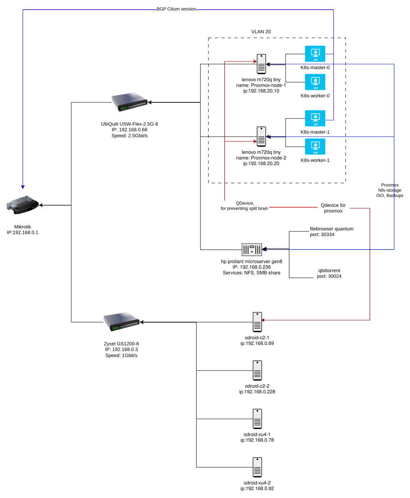

# Homelab Infrastructure as Code

This repository manages a homelab stack across Proxmox, MikroTik, Kubernetes, and ARM/x86 hosts using Terraform, Packer, and Ansible.
All solution are not production ready. Use at your own risk and adapt as needed for your environment.

Main idea is to create in homelab, cloud like infrastructure, with a focus on Kubernetes and BGP networking, with limited resources.


## Network arhitecture


## Main components:

- Proxmox VE: Hypervisor for running VMs (Kubernetes nodes).
- Packer: Builds Proxmox VM templates (Golden images) with cloud-init for Kubernetes images with cilium and longhorn for HA.
- Terraform: Provisions MikroTik router config and Proxmox VMs for Kubernetes cluster, with BGP peering and Cilium integration, and Longhorn (WIP)
- Ansible: Post-provisioning configuration of Proxmox, ODROID hosts, and monitoring stack.

## Structure of repository

- `terraform/mikrotik`: RouterOS VLAN, DHCP, DNS, firewall, and BGP base config.
- `terraform/ubuntu_k8s`: Proxmox VM creation + cloud-init + kubeadm bootstrap + Cilium BGP config.
- `packer/ubuntu2404_k8s`: Proxmox template build for Ubuntu-based Kubernetes nodes.
- `proxmox_vms`: Ansible playbooks/roles for Proxmox-side setup tasks.
- `home_lab`: Ansible playbooks/roles for ODROID hosts, Docker, and monitoring.
- `k8s_ymls`: Example Kubernetes Pod + LoadBalancer Service manifests.
- `scripts`: Utility scripts (for example, Proxmox Terraform user/token bootstrap).

## Prerequisites

Install and configure these on your control machine:

- Terraform (with access to `telmate/proxmox` and `terraform-routeros/routeros` providers)
- Packer (with `github.com/hashicorp/proxmox` plugin)
- Ansible
- SSH keypair (`~/.ssh/id_ed25519` and `~/.ssh/id_ed25519.pub`)
- Network reachability to Proxmox and MikroTik management interfaces

## Recommended workflow

### 1) Prepare credentials using example files

Use templates and keep real secrets out of Git-tracked files.

```bash
cp terraform/unbuntu_k8s/example.tfvars terraform/unbuntu_k8s/secrets.tfvars
cp terraform/mikrotik/example.tfvars terraform/mikrotik/secrets.tfvars
cp packer/ubuntu2404_k8s/example.pkrvars.hcl packer/ubuntu2404_k8s/secrets.pkrvars.hcl
cp home_lab/vars/proxmox/vault.example.yml home_lab/vars/proxmox/vault.yml
cp proxmox_vms/vars/proxmox/vault.example.yml proxmox_vms/vars/proxmox/vault.yml
```

### 2) (Optional) Create Proxmox Terraform API user/token

```bash
bash scripts/init_proxmox_user.sh
```

### 3) Build Proxmox VM template with Packer

```bash
cd packer/ubuntu2404_k8s
packer init packer.pkr.hcl
packer build -var-file=secrets.pkrvars.hcl packer.pkr.hcl
```

### 4) Provision MikroTik networking

```bash
cd terraform/mikrotik
terraform init
terraform plan -var-file=secrets.tfvars
terraform apply -var-file=secrets.tfvars
```

### 5) Provision Kubernetes VMs on Proxmox

```bash
cd terraform/unbuntu_k8s
terraform init
terraform plan -var-file=secrets.tfvars
terraform apply -var-file=secrets.tfvars
```

### 6) Configure hosts and services with Ansible

```bash
cd proxmox_vms
ansible-playbook provision_proxmox.yml
ansible-playbook download_images.yml

cd home_lab
ansible-playbook setup_ssh.yml
ansible-playbook provision_odroids.yml
ansible-playbook monitoring.yml
```

## Kubernetes sample manifests

From `k8s_ymls/`:

```bash
kubectl apply -f k8s_ymls/pod.yml
kubectl apply -f k8s_ymls/service.yml
```

## Useful entry points

- Proxmox provider config: `terraform/unbuntu_k8s/provider.tf`
- Kubernetes bootstrap logic: `terraform/unbuntu_k8s/main.tf`
- MikroTik provider config: `terraform/mikrotik/provider.tf`
- ODROID inventory: `home_lab/inventory.ini`
- Packer template: `packer/ubuntu2404_k8s/packer.pkr.hcl`